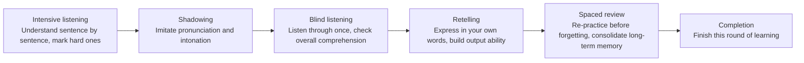

<div align="right">
  <a href="./README.en.md">English</a> | <a href="./README.md">简体中文</a> | <strong>日本語</strong>
</div>

<div align="center">
  

  <h1>Echo Loop — 最もプロフェッショナルな英語精聴アプリ</h1>

  <p><strong>英語の練習方法を、もう自分で考える必要はありません。</strong></p>

  <p>精聴 · シャドーイング · ブラインドリスニング · リテリング · 復習 — Echo Loop が科学的なペースで、すべてのステップを導きます。</p>

  <p><sub><em>このプロジェクトは、中央民族大学外国語学院の<a href="https://sfs.muc.edu.cn/info/1063/3729.htm"> Yang Yan</a> 氏から学術的な助言を受けています。</em></sub></p>

  <p>
    <a href="./LICENSE"></a>
    
    <a href="https://github.com/echo-loop/Echo-Loop/releases/latest"></a>
    <a href="https://github.com/echo-loop/Echo-Loop/releases"></a>
    <a href="https://github.com/echo-loop/Echo-Loop/commits/main"></a>
  </p>

  <p>
    <a href="https://trendshift.io/repositories/41519?utm_source=trendshift-badge&amp;utm_medium=badge&amp;utm_campaign=badge-trendshift-41519" target="_blank" rel="noopener noreferrer"></a>
  </p>

  <p>
    <a href="https://apps.apple.com/app/id6760324074"></a>
    <a href="https://play.google.com/store/apps/details?id=app.echoloop"></a>
  </p>
</div>

---

## 📖 Echo Loop とは

ひとことで言えば、**Echo Loop は最もプロフェッショナルな英語精聴アプリ**であり、科学に基づいた英語のリスニングとスピーキングのトレーナーです。1 つの音声を「知らない」状態から「本当に理解できた」状態まで持っていき、さらにシャドーイングとリテリングで、自然に口に出せるようになるまでループを完結させます。間隔をあけた復習とリマインダーがリズムを自動で進めてくれるので、方法を考えたり、進め方を管理したりする必要はありません。練習にだけ集中してください。

Echo Loop は 4 つのステップであなたを導きます。

- **まずは精聴**: 素材を 1 文ずつ理解し、難しい文に印を付けます
- **シャドーイング**: 発音、リズム、イントネーションを合わせます
- **ブラインドリスニング**: スクリプトなしで全体の理解度を確かめます
- **リテリング**: 聞いた内容を自分の言葉で表現します

最初の学習のあとは間隔をあけた復習で素材を定着させ、難しい文や新しい単語は身につくまで繰り返し出てきます。

---

## 📱 スクリーンショット

<table>
  <tr>
    <td align="center"><br/><sub>音声をインポートして、すぐに練習</sub></td>
    <td align="center"><br/><sub>科学的な練習、聞く・話すのループ</sub></td>
    <td align="center"><br/><sub>自動リマインダー、見える進捗</sub></td>
    <td align="center"><br/><sub>1 文ずつの精聴</sub></td>
    <td align="center"><br/><sub>意味のまとまりで分割、難しい文の分析</sub></td>
  </tr>
  <tr>
    <td align="center"><br/><sub>リテリング: 理解をアウトプットに変える</sub></td>
    <td align="center"><br/><sub>難しい文を保存して、身につくまで練習</sub></td>
    <td align="center"><br/><sub>元の文脈付きのフラッシュカード復習</sub></td>
    <td align="center"><br/><sub>自分のペースで自由に練習</sub></td>
    <td align="center"></td>
  </tr>
</table>

---

## ✨ 機能

- 🤖 **自動で進む学習リズム**: シャドーイングの回数、復習のタイミング、難しい文への印付けがすべて自動で進みます。あなたは聞くことと話すことに集中するだけです。
- 🎯 **聞く・話すのループ**: 精聴、シャドーイング、リテリングがシームレスにつながります。内容の理解から、表現の模倣、そして自分の言葉で話すところまで進みます。
- 🧩 **長い文を意味のまとまりで分割**: 長い文を意味のまとまりで区切り、複雑な構造を消化しやすい単位に分けます。
- ⭐ **難しい文を保存して、いつでも復習**: 難しい文は自動で保存され、集中的なシャドーイングと反復練習に使えます。「印を付けたまま忘れる」ことはもうありません。
- 📚 **文脈付きのフラッシュカード復習**: 保存した単語や意味のまとまりを、元の文の文脈と一緒に復習します。切り離して覚えるのではなく、文脈の中で覚えられます。
- 💡 **AI による翻訳、分析、語彙の解説**: 対訳、文の分析、単語の用法とコロケーションを、学習の流れを止めずに必要なときだけ展開できます。
- 📍 **中断したところから再開**: 今いるステージと文を自動で記録するので、すぐに再開できます。5 分のすき間時間も無駄になりません。
- 📊 **学習統計**: 練習時間、インプットとアウトプットの比率、異なり語数を記録し、どれだけ練習して話したかが正確にわかります。
- 🎙️ **AI によるシャドーイング評価**: 音声認識の結果を原文と自動で照合し、一致した単語をハイライトして、シャドーイングを評価します。
- 🎧 **ローカルの音声・動画のインポート + AI 字幕**: ローカルの音声と動画を一括でインポートし、既存の字幕を取り込むことも、AI で自動文字起こしすることもできます。
- 🎬 **動画での学習**: 映像は各文と同期し、映像を隠して音声だけで聞くこともできます。字幕マスクで、動画に焼き付けられた元の字幕を隠せます。
- ✏️ **字幕の編集とメディアのトリミング**: 文の分割、結合、打ち直し、削除ができ、波形の上で直接タイミングを調整できます。クリップを切り出してエクスポートすることもできます。字幕を編集したあとも、お気に入りと学習の進捗は時間の範囲で保持されます。
- 🔍 **手動での単語検索**: 学習ページからいつでも単語を調べられ、検索履歴が残り、必要に応じて AI の解説に切り替えられます。
- 📅 **毎日の目標とチェックイン**: 1 日の学習時間の目標を設定できます。達成すると自動でチェックインされ、シェアできるチェックインカードが作られます。
- 📄 **PDF エクスポート**: 学習素材、保存した文、保存した単語を、印刷できる PDF のノートとしてエクスポートできます。

---

## 🤔 なぜこれを作ったのか

ほかの英語学習アプリを使うときは、自分で決めなければなりません。今日は何回聞くべきか。精聴か多聴か。まだ身についていないのはどの文か。シャドーイングすべきか。いつ復習すべきか。

**こうした判断そのものが、意志の力を消耗させます。** 理解できないのではなく、次に何をすればいいのかがわからないのです。

Echo Loop は、そうした判断をあなたの代わりに引き受けます。理解したい音声を選んでスタートを押せば、精聴から完了まで、どのステップでも「今やること」を教えてくれます。

あなたはアプリを開き続けるだけで、残りは Echo Loop が引き受けます。1 つの素材をしっかり練習するほうが、適当に 100 個聞くよりも効果があります。

---

## 🆚 ほかの方法との違い

比較のために、中国の学習者になじみのある英語学習アプリを 4 つ選びました。個々の機能は、多かれ少なかれほかのアプリにもあります。しかし Echo Loop の本当の違いは、**すべてのステップをつなぎ、自動であなたを導くことです。方法を考えたり、繰り返しの回数を管理したり、復習の間隔を管理したりする必要はありません。**

| 機能 | Echo Loop | Daily English Listening | Kekenet | Liulishuo | Anki |
|---|---|---|---|---|---|
| **アプリが進める学習リズム** | ✅ 完全自動 | ❌ | ❌ | ❌ | ❌ |
| 聞く → 話すのループ（精聴 + シャドーイング + **リテリング**） | ✅ | ⚠️ 一部 | ⚠️ 一部 | ⚠️ 一部 | ❌ |
| **長い文を意味のまとまりで分割** | ✅ | ❌ | ❌ | ❌ | ❌ |
| **保存した文の集中復習** | ✅ | ❌ | ❌ | ❌ | ❌ |
| **文脈付きのフラッシュカード復習** | ✅ | ❌ | ❌ | ❌ | ⚠️ 手動でカード作成が必要 |
| AI 翻訳 / 文の分析 / 単語の詳しい解説 | ✅ | ⚠️ 一部 | ⚠️ 一部 | ❌ | ❌ |
| **中断したところから再開** | ✅ | ⚠️ 一部 | ⚠️ 一部 | ⚠️ 一部 | ⚠️ 一部 |
| 統計: 時間 / インプットとアウトプットの比率 / 異なり語数 | ✅ | ⚠️ 一部 | ⚠️ 一部 | ⚠️ 一部 | ❌ |
| AI によるシャドーイング評価 | ✅ | ✅ | ✅ | ✅ | ❌ |
| ローカルの音声・動画のインポート | ✅ | ✅ | ❌ | ❌ | ⚠️ 手動でカード作成 |
| オフラインで利用可能 | ✅ | ✅ | ✅ | ⚠️ 一部 | ✅ |
| オープンソース | ✅ | ❌ | ❌ | ❌ | ✅ |

---

## 🧠 学習方法

**精聴 → シャドーイング → ブラインドリスニング → リテリング → 間隔をあけた復習 → 完了。**



**上のすべてのステップは Echo Loop が自動で進めます。判断は必要ありません。**

「何回聞けばいいか」「先週の素材を復習する時期か」を管理する必要はありません。アプリを開けば、今日やることが目の前に表示されます。

学習の過程はすべて数値で示されます: **練習時間 · インプットとアウトプットの比率 · 異なり語数**。

<details>
<summary><strong>間隔をあけた復習はどのようにスケジュールされますか？</strong></summary>

1 つの素材は、1 回の最初の学習と 7 回の間隔をあけた復習に分けられます。復習の間隔は 6 時間から 14 日まで広がり、7 回の復習で合計およそ 28 日をカバーします。忘れる直前に記憶を呼び起こすもので、エビングハウスの忘却曲線に沿っています。

| ステージ | 前回からの間隔 | タスク |
|---|---|---|
| 最初の学習 | — | 精聴 → シャドーイング → ブラインド → リテリング |
| 復習 1 | 6 時間後 | 難しい文のドリル + リテリング |
| 復習 2 | 18 時間後 | ブラインドリスニング + ドリル + リテリング |
| 復習 3 | 1 日後 | ブラインドリスニング + ドリル + リテリング |
| 復習 4 | 2 日後 | ブラインドリスニング + ドリル + リテリング |
| 復習 5 | 3 日後 | ブラインドリスニング + ドリル + リテリング |
| 復習 6 | 7 日後 | ブラインドリスニング + ドリル + リテリング |
| 復習 7 | 14 日後 | ブラインドリスニング + ドリル + リテリング |

</details>

---

## 📥 ダウンロードして試す

<table>
  <tr>
    <td valign="middle">
      <p>
        <a href="https://apps.apple.com/app/id6760324074"></a>
        &nbsp;
        <a href="https://play.google.com/store/apps/details?id=app.echoloop"></a>
        &nbsp;
        <a href="https://github.com/echo-loop/Echo-Loop/releases"></a>
      </p>
      <p><sub>デスクトップ: macOS は開発中 · Windows は予定あり · Web は予定なし</sub></p>
    </td>
    <td valign="middle" align="center" width="120">
      <br/>
      <sub>スキャンして iOS 版をダウンロード</sub>
    </td>
    <td valign="middle" align="center" width="120">
      <br/>
      <sub>スキャンして Android 版をダウンロード</sub>
    </td>
  </tr>
</table>

---

## ❓ よくある質問

<details>
<summary><strong>Echo Loop は無料ですか？</strong></summary>

主要な機能はすべて無料で、利用回数の上限も項目数の制限もありません。

- **無制限のインポート**: ローカルファイル、リンク、Baidu Netdisk、ポッドキャストの購読
- **無制限のお気に入り**: 難しい文、単語、意味のまとまりを好きなだけ保存できます
- **学習ループのすべて**: 精聴、シャドーイング、ブラインドリスニング、リテリングに加え、リマインダー付きの 7 回の間隔をあけた復習
- **難しい文の集中復習 + 文脈付きのフラッシュカード**
- **シャドーイング評価**: システムまたは端末上のオフライン音声認識を使い、回数の制限はありません
- **オフラインの文字起こし**: モデルをダウンロードすれば、サインインなしで端末上で字幕を作成できます
- **辞書検索、学習統計、PDF ノートのエクスポート、バックアップと復元**

AI による解説機能には毎月の無料枠があり、ほとんどの人の日常的な学習はそれで足ります。AI をたくさん使う人だけ、アプリ内でメンバーシップにアップグレードする必要があります。

</details>

<details>
<summary><strong>AI の利用枠を使うのはどの機能ですか？</strong></summary>

AI による解説機能だけです。AI 翻訳、文の分析、意味のまとまりでの分割、単語の分析、AI 学習アシスタント、リテリングの評価、クラウドでの文字起こしが該当します。上に挙げた無料の機能は、どれも利用枠を使いません。

</details>

<details>
<summary><strong>無料枠を使い切るとどうなりますか？</strong></summary>

通常どおり学習を続けられます。AI 機能は翌月に枠がリセットされると再び使えるようになります。待ちたくない場合は、アプリ内でメンバーシップにアップグレードできます。

</details>

<details>
<summary><strong>オープンソースのプロジェクトなのに、なぜ料金がかかるのですか？</strong></summary>

コードは完全にオープンソース（AGPL-3.0）です。AI へのリクエストのたびに、私たちはモデルのプロバイダーに料金を支払っています。メンバーシップはその費用をまかない、プロジェクトを続けるためのものです。

</details>

<details>
<summary><strong>どのプラットフォームに対応していますか？</strong></summary>

現在は **iOS と Android** に注力しています。App Store または Google Play から入手するか、[Releases](https://github.com/echo-loop/Echo-Loop/releases) から Android の APK をダウンロードしてください。ネイティブの macOS 版は開発中で、Windows 版も予定しています。どちらも後日、正式にリリースされます。

今すぐパソコンで使うには:

- **Mac（Apple silicon）**: Mac App Store で Echo Loop を検索し、iOS 版を直接インストールします
- **Windows**: Tencent のアプリストア YingYongBao（应用宝）をインストールし、その中で Echo Loop の Android APK をインストールします

</details>

<details>
<summary><strong>ほかの英語アプリとは何が違いますか？</strong></summary>

ほかのアプリの多くは素材とツールを提供し、練習の仕方は自分で考えるように任せています。Echo Loop は *どう練習するか* を引き受けます。精聴、シャドーイング、ブラインドリスニング、リテリング、間隔をあけた復習が 1 つの流れとして進み、アプリがどのステップでもやることを教えてくれます。計画を立てたり、繰り返しの回数を数えたり、復習の日付を管理したりする必要はありません。詳しい比較は、上の「🆚 ほかの方法との違い」をご覧ください。

</details>

<details>
<summary><strong>どんな素材に対応していますか？</strong></summary>

- **音声**: mp3、m4a、wav、aac、flac、opus、ogg
- **動画**: mp4、mov、m4v、mkv、webm、avi（映像を隠して音声だけで練習することもできます）
- **字幕**: srt、vtt、lrc。音声と同じ名前の字幕ファイルは自動で組み合わされます。字幕がない場合は、AI の文字起こしで作成できます
- **ソース**: ローカルファイル、音声への直接リンク、Baidu Netdisk、ポッドキャストの購読

ポッドキャスト、TED トーク、テレビ番組のクリップ、教材の音声などに使えます。最も効果を出すには、**興味があり、今のレベルより少し上の**内容を選んでください。

</details>

<details>
<summary><strong>どのくらいの英語力が必要ですか？</strong></summary>

字幕があれば素材のおおまかな内容を追えるなら、始められます。わかりにくい文は、意味のまとまりでの分割、AI 翻訳、文の分析で分解してください。基礎を固めている最中なら、短くてゆっくりした素材から始めましょう。

</details>

<details>
<summary><strong>どのくらいで効果が出ますか？</strong></summary>

ある素材の最初の学習を終えると、その内容を理解し、自分の言葉でリテリングできるようになります。続く 7 回の間隔をあけた復習はおよそ 4 週間で終わり、内容を長期記憶に定着させます。リスニングとスピーキングの総合的な力は時間をかけて伸びていきます。1 日 20〜30 分、2〜3 個の素材を並行して練習すれば、数週間でリスニングが楽になり、話すのも滑らかになるはずです。

</details>

<details>
<summary><strong>オフラインで使えますか？</strong></summary>

はい。学習の流れ、復習、お気に入り、シャドーイング評価、ローカルでの文字起こしはすべてオフラインで使えます。辞書の検索とクラウドの AI 機能にはネットワーク接続が必要です。

</details>

<details>
<summary><strong>データはどこに保存されますか？ スマートフォンを買い替えたら？</strong></summary>

学習データは端末に保存されます。スマートフォンの買い替えや再インストールの前に、**Settings → Backup & Restore** からバックアップをエクスポートし、新しい端末で復元してください。

</details>

---

## 💬 コミュニティに参加する

真剣に学ぶほかの学習者と一緒に英語を練習しましょう。方法を共有し、フィードバックを送り、新機能をいち早く知ることができます。

- [QQ グループに参加する (1109595757)](https://qm.qq.com/q/f4YeczPPUc): 真剣に学ぶほかの学習者と学習方法や素材を共有できます。
- [WeChat で連絡する](https://i.postimg.cc/P5tVpPTV/echo-loop-wecom.jpg): QR コードをスキャンして Echo Loop に連絡できます。
- [Bilibili でフォローする](https://space.bilibili.com/509449049/upload/video): 英語学習のコンテンツと機能の更新情報を受け取れます。
- [Xiaohongshu でフォローする](https://xhslink.cn/m/4zOdGUcDH4N): 実践的なヒント、機能の更新情報、英語学習のコンテンツを受け取れます。

---

## 🗺️ ロードマップ

### ✅ 1 · 主要な機能

- [x] 学習ループ: 精聴 / シャドーイング / ブラインド / リテリング
- [x] 間隔をあけた復習のスケジュール（6 時間 → 14 日、合計 28 日）
- [x] 長い文を意味のまとまりで分割
- [x] 難しい文の保存 + 集中復習
- [x] 文脈付きのフラッシュカード復習
- [x] AI 翻訳 / 文の分析
- [x] iOS / macOS のネイティブ音声認識によるシャドーイング評価
- [x] 中断したところから再開
- [x] 学習統計
- [x] 字幕マスク付きの動画学習
- [x] 字幕エディターとメディアのトリミング
- [x] 手動での単語検索と検索履歴
- [x] 毎日の目標とチェックイン
- [x] PDF エクスポート（素材 / お気に入り）

### 🚧 2 · AI の機能

- [ ] AI の会話パートナー
- [x] AI 学習アシスタント（必要なときに質問できる）
- [x] AI による単語検索
- [ ] パーソナライズされた素材のおすすめ

### 🔭 3 · 体験とプラットフォーム

- [ ] カスタムのタスクフロー
- [ ] 連続記録 / 学習バッジ
- [ ] macOS / Windows のデスクトップ版の正式リリース

### 🔭 4 · コンテンツのエコシステム

- [ ] 公式の厳選コレクション（トピック + 難易度別）
- [ ] ユーザーが共有するコレクション / UGC の学習素材

---

## ⭐ Star History

<a href="https://www.star-history.com/?repos=echo-loop%2FEcho-Loop&type=date&legend=top-left">
 <picture>
   <source media="(prefers-color-scheme: dark)" srcset="https://api.star-history.com/chart?repos=echo-loop/Echo-Loop&type=date&theme=dark&legend=top-left&sealed_token=Yn1CvBygp-TANTMrrjOoIPcBqfBW4dJBno9qMlDVPTRaqlNZEvy5k6QNjheAb8AxwJ3ygwow4Zszp0Z5XCtxf7OP4MOtE_fCjKTjyBALH5gvoX-6BOLIIQ" />
   <source media="(prefers-color-scheme: light)" srcset="https://api.star-history.com/chart?repos=echo-loop/Echo-Loop&type=date&legend=top-left&sealed_token=Yn1CvBygp-TANTMrrjOoIPcBqfBW4dJBno9qMlDVPTRaqlNZEvy5k6QNjheAb8AxwJ3ygwow4Zszp0Z5XCtxf7OP4MOtE_fCjKTjyBALH5gvoX-6BOLIIQ" />
   
 </picture>
</a>

---

## 🎓 学術指導と謝辞

**学術指導**

このプロジェクトの学習方法を指導してくださった [Yang Yan](https://sfs.muc.edu.cn/info/1063/3729.htm) 氏（中央民族大学外国語学院、北京大学で英語言語文学の博士号を取得）に感謝します。

**主な依存関係**

- 音声と動画: [just_audio](https://pub.dev/packages/just_audio) · [audio_session](https://pub.dev/packages/audio_session) · [media_kit](https://pub.dev/packages/media_kit) · [ffmpeg_kit_flutter_new_min](https://pub.dev/packages/ffmpeg_kit_flutter_new_min)
- 音声処理: [flutter_tts](https://pub.dev/packages/flutter_tts) · [sherpa_onnx](https://pub.dev/packages/sherpa_onnx)
- データと状態: [drift](https://pub.dev/packages/drift) · [flutter_riverpod](https://pub.dev/packages/flutter_riverpod)
- テキスト処理: [subtitle](https://pub.dev/packages/subtitle) · [lemmatizerx](https://pub.dev/packages/lemmatizerx)
- システム機能: [file_picker](https://pub.dev/packages/file_picker) · [flutter_local_notifications](https://pub.dev/packages/flutter_local_notifications)

---

## 🧑‍💻 開発者向け

<details open>
<summary><strong>🚀 クイックスタート</strong></summary>

```bash
git clone git@github.com:echo-loop/Echo-Loop.git
cd Echo-Loop
cp .dev.env.template .dev.env   # fill in Supabase / Google settings
flutter pub get
dart run build_runner build
flutter run -d <ios|android|macos> --dart-define-from-file=.dev.env
```

> Supabase、Google などのコンパイル時の設定は `.dev.env`（デバッグ）/ `.prod.env`
> （リリース）に置かれ、`--dart-define-from-file` で注入されます。どちらのファイルも gitignore されています。
> グローバルの API はデフォルトで `https://www.echo-loop.top` で、コンパイル時に
> `API_BASE_URL` で上書きできます。静的 CDN のアドレスは
> `lib/config/regional_service_endpoints.dart` で設定されています。
> 中国の API はデフォルトで `https://www.echo-loop.cn` で、
> `API_CHINA_BASE_URL` で上書きできます。ローカルのビルドでは `.prod.env` で上書きでき、GitHub Actions の CI/Release
> では対応する GitHub Variables がビルドコマンドに直接渡されます。
> リリースビルドでは 1 つの `isChinaUser` の判定結果を使います。中国の Apple Storefront、端末の国、または
> `/api/v1/client/config` の `context.countryCode` が `CN`/`CHN` の場合に中国が選ばれるため、1 つのパッケージに
> グローバルと中国の両方の API 候補が含まれ、両方の地域に対応できます。中国であることを示す情報がない場合、
> 最初の API リクエストはグローバルのエンドポイントを使います。地域の判定が変わると、
> アプリは現在の API エンドポイントを使い続けながら、
> 設定のリクエストで新しい優先先を確認します。ネットワークエラーや 5xx の場合は、もう一方の地域を 1 回試します。
> 確認に成功すると優先する地域が有効になります。代替先で成功した場合は、そのセッションの間は API リクエストを
> 利用できるエンドポイントで続け、後で設定を更新するときに優先先を再び確認します。
> モデルの CDN のルーティングは常に `isChinaUser` に従い、上書きが設定されていない場合はソースの API のデフォルトが適用されます。

</details>

<details>
<summary><strong>🤝 コントリビュートの方法</strong></summary>

Issue と PR を歓迎します。提出する前に、次のコマンドを実行してください。

```bash
flutter analyze
flutter test
```

コミットのタイトルは `PREFIX: content` の形式に従います（よく使われるプレフィックスは `git log` で確認してください。FEAT / FIX / DOCS / MOD / OPT / CHORE / CI / RELEASE などです）。詳しいコントリビューションガイドは [CONTRIBUTING.md](#)（未作成）に置く予定です。このプロジェクトは [Contributor Covenant](https://www.contributor-covenant.org/) の行動規範に従います。

</details>

<details>
<summary><strong>🛠️ 技術スタック</strong></summary>


| 分類 | 技術 | 用途 |
|------|------|------|
| UI フレームワーク | Flutter + Material 3 | クロスプラットフォームの UI |
| 状態管理 | Riverpod（コード生成） | 単方向のデータフロー |
| 音声の再生 | just_audio + audio_session | 音声エンジン層 |
| 動画とデコード | media_kit + FFmpeg (ffmpeg_kit_flutter_new_min) | 動画の再生、音声のデコード、波形の生成、クリップのエクスポート |
| オフライン音声認識 | sherpa_onnx | 端末上での文字起こしとシャドーイングの認識 |
| 字幕の解析 | subtitle | SRT/VTT。LRC は独自のパーサーで処理 |
| PDF エクスポート | pdf + printing | 学習素材とお気に入りのノート |
| サインインとサブスクリプション | Supabase · RevenueCat · Paddle | アカウントのサインイン、メンバーシップ、AI の利用枠 |
| ファイル選択 | file_picker | ローカルの音声・動画・字幕のインポート |
| 永続化 | Drift (SQLite) + shared_preferences | 進捗、お気に入り、キャッシュ |
| 多言語対応 | flutter_localizations + ARB | 简体中文 / English |
| テスト | flutter_test + mocktail | ユニット / ウィジェット / 統合 |
| 静的解析 | flutter_lints | コードスタイル |

</details>

<details>
<summary><strong>📁 プロジェクト構成</strong></summary>

```
lib/
├── database/          # Drift database: table definitions and DAOs
├── features/          # Feature modules by domain (subtitle editing, media trim, subscriptions, daily goals, AI chat assistant, etc.)
├── l10n/              # i18n files (ARB format)
├── models/            # Data models (AudioItem, Sentence, Collection, etc.)
├── providers/         # Riverpod state management (audio_engine, media_engine, listening_practice, etc.)
├── screens/           # Pages
├── services/          # Service layer (ASR, dictionary, TTS, backup, PDF export, etc.)
├── router/            # Routing
└── widgets/           # Reusable components

integration_test/      # End-to-end tests
test/                  # Unit / widget tests
maestro/               # Maestro UI smoke flows
```

</details>

<details>
<summary><strong>⌨️ 開発コマンドの早見表</strong></summary>

**実行**

```bash
flutter run -d ios            # iOS
flutter run -d android        # Android
flutter run -d macos          # macOS (in development, unreleased)
flutter run -d chrome         # Web (debug only, no release plan)

# iOS Simulator
xcrun simctl list devices available
xcrun simctl boot <DEVICE_UDID>
open -a Simulator
```

**テスト / 品質チェック**

```bash
flutter analyze                          # Static analysis
flutter test                             # All tests
flutter test integration_test -d macos   # Integration tests
# Maestro UI smoke test (start a device and install the dev build first)
MAESTRO_APP_ID=app.echoloop.dev scripts/test_maestro.sh
# Android device: build, install the dev build, then run the Study tests
scripts/test_maestro_android.sh
# With multiple devices, specify the target; alternatively export MAESTRO_ANDROID_DEVICE=<adb-serial> once
scripts/test_maestro_android.sh --device <adb-serial>
dart format .                            # Format
```

> Maestro CLI は `curl -fsSL https://get.maestro.mobile.dev | bash` でインストールします。
> iOS の開発ビルドでは `MAESTRO_APP_ID=top.echo-loop.dev` を使います。フローは `maestro/` にあります。

**コード生成**（Riverpod のプロバイダーを変更したあと）

```bash
dart run build_runner build
```

**ビルド**

```bash
# Supabase / Google compile-time variables are injected from an env file (.prod.env for release)
flutter build macos --dart-define-from-file=.prod.env
flutter build apk   --dart-define-from-file=.prod.env
flutter build ios   --dart-define-from-file=.prod.env

# Run on device
flutter run --release -d <DEVICE_ID> --dart-define-from-file=.dev.env
```

> リリース用のスクリプト `scripts/run_simulator.sh`（`.dev.env` を読み込みます）と
> `scripts/release_{android,ios,macos}.sh`（`.prod.env` を読み込みます）は、すでに
> `--dart-define-from-file` を渡してくれます。

**動作要件**

- Flutter 3.47.9+ / Dart 3.13+（`pubspec.yaml` を参照）
- iOS シミュレーター / Android エミュレーター / 実機
- デスクトップ: macOS / Windows / Linux の開発環境

</details>

---

中国のユーザー向けの AtomGit ミラー: <a href="https://atomgit.com/echo-loop/Echo-Loop">Echo Loop on AtomGit</a>

## 📄 ライセンス

[AGPL-3.0](./LICENSE)
